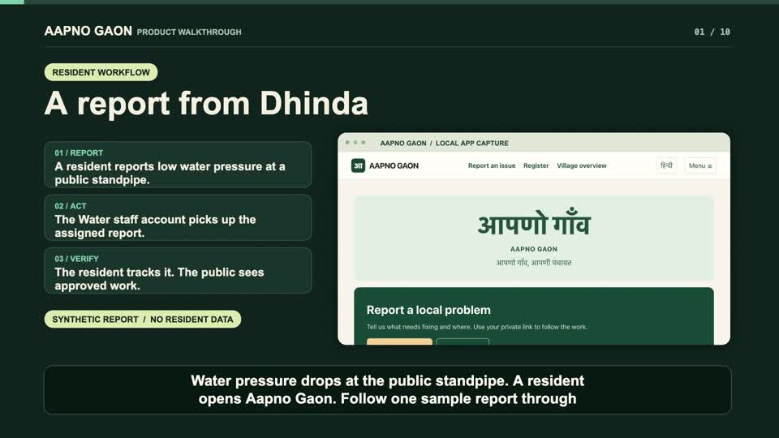
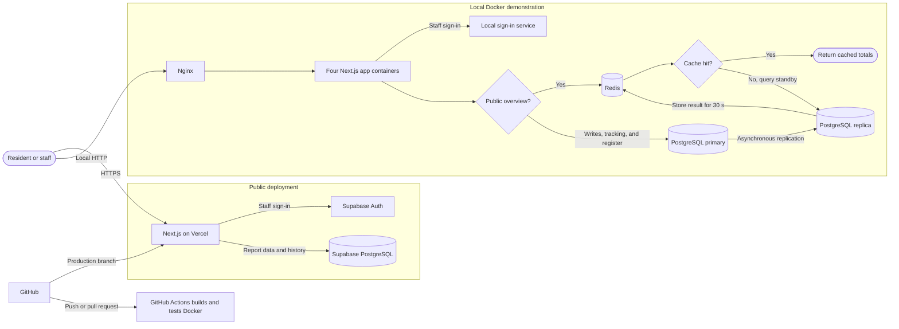
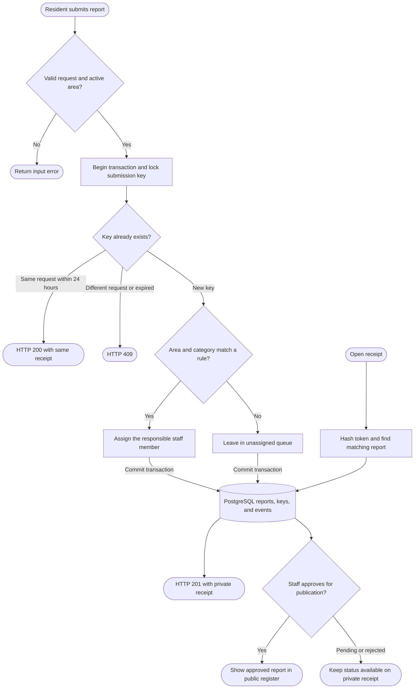
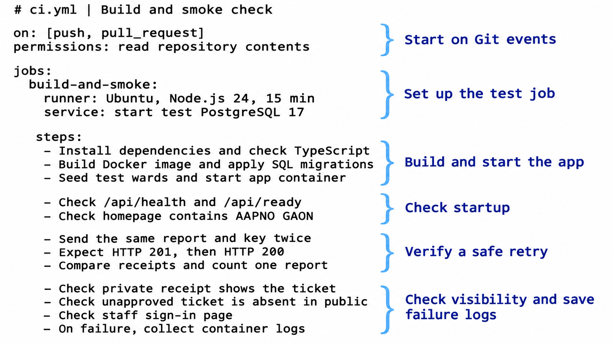
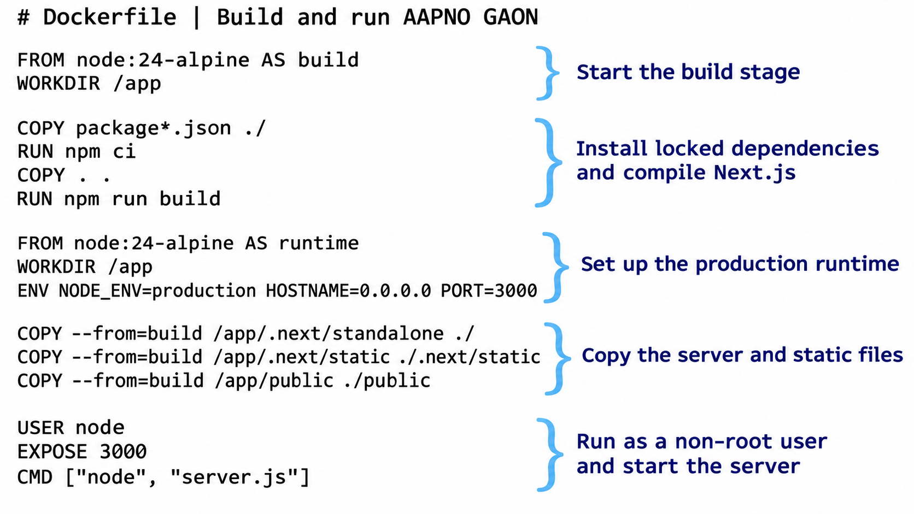

# AAPNO GAON

आपणो गाँव, आपणी पंचायत

Residents report local problems and track them. Staff review reports, publish due dates, and record resolutions.

[Live app](https://aapno-gaon.vercel.app) · [GitHub Actions](https://github.com/labishbardiya/aapno-gaon/actions) · [Merged report intake PR](https://github.com/labishbardiya/aapno-gaon/pull/1)

[](https://aapno-gaon.vercel.app/walkthrough/index.html)

[Product walkthrough and scaling animation](https://aapno-gaon.vercel.app/walkthrough/index.html) · [Product MP4 in this repository](public/walkthrough/demo.mp4) · [Scaling MP4 in this repository](public/walkthrough/scaling.mp4)

## Command summary

Use a terminal with Git, Docker Desktop with Compose v2, Bash, Python 3, curl, jq, and OpenSSL. Run the commands in order. The supplied Compose stack uses synthetic data, a local sign-in service, and loopback ports. It works with no Supabase account.

| Task | Command | What it does |
|---|---|---|
| Start or rebuild | `docker compose up -d --build --wait` | `up` starts the services. `-d` leaves them running in the background. `--build` rebuilds the app image. `--wait` waits for the services to start and pass configured health checks. |
| Inspect the stack | `docker compose ps` | Lists services, their state, and the ports on the host. |
| Verify scaling | `bash verify.sh` | Checks one replica read, shared Redis hits, a write replicated from the primary, and request delivery with one app container stopped. It restarts that container. |
| Compare algorithms | `python3 compare-balancers.py --requests 6000 --workers 24 --seconds 15` | Sends 6,000 reads per algorithm with up to 24 concurrent workers over about 15 seconds. Use `--algorithm` to select one route. |
| Watch CPU | `docker stats` | Streams the CPU percentage and other resource samples for running containers. |
| Check HTTP | `curl -sS -i URL` | `-sS` hides progress and keeps errors. `-i` shows the status and headers. Add `-f` when an HTTP error should fail the command. |
| Stop or restart a service | `docker compose stop SERVICE`, `docker compose start SERVICE` | Stops or starts an existing container. The outage drill uses the local `primary` service. |
| Read logs | `docker compose logs --tail 50 SERVICE` | Prints the last 50 lines from one service. |
| Run a database tool | `docker compose exec -T primary COMMAND` | Runs a command in the primary container. `-T` disables the terminal so pipes and redirects work. |
| Stop the stack | `docker compose down` | Removes containers and the network. Named database volumes are kept. |

## 1. Run the application in Docker

For a fresh checkout, use:

```sh
git clone https://github.com/labishbardiya/aapno-gaon.git
cd aapno-gaon/demo/scale
export COMPOSE_PROJECT_NAME=aapno-scale-check
docker compose up -d --build --wait
docker compose ps
curl --retry 10 --retry-connrefused -fsS http://127.0.0.1:3195/api/health
curl -fsS http://127.0.0.1:3195/api/ready
```

For an existing checkout, start in its `demo/scale` directory. Set `COMPOSE_PROJECT_NAME` to the running project name. The commands in this guide use `aapno-scale-check`.

Open [the local app](http://127.0.0.1:3195), the [report form](http://127.0.0.1:3195/report), the [public register](http://127.0.0.1:3195/register), the [overview](http://127.0.0.1:3195/overview), and [staff sign-in](http://127.0.0.1:3195/staff). All local staff accounts use `@demo.example` and the local password `DhindaDemo2026`. Use `water` for water reports, `works` for roads and streetlights, `sanitation` for waste and drainage, and `coordinator` for administration. These accounts exist in the local sign-in service.

1. Submit a report for **Dhindha → Water**. Save its private receipt link.
2. Search for the ticket in the public register. The search returns no match before approval.
3. Sign in as `water@demo.example`. Approve the report, publish a due date, and start work.
4. Resolve the report and enter a public note. If you add a photo, review it before you allow publication.
5. Refresh the private receipt and the public entry. Check the village overview.

### Retry the same submission and verify the response

Run this once per demo. A new key starts a new report and uses the local daily submission allowance.

```sh
key=$(python3 -c 'import uuid; print(uuid.uuid4())')
body='{"wardId":1,"category":"water","landmark":"Demo standpipe","description":"Low water pressure"}'
for response in receipt retry; do
  curl -fsS -w 'HTTP %{http_code}\n' -o "/tmp/aapno-$response.json" \
    -H "Idempotency-Key: $key" -H 'Content-Type: application/json' \
    --data "$body" http://127.0.0.1:3195/api/reports
done
diff -u /tmp/aapno-receipt.json /tmp/aapno-retry.json
ticket=$(jq -er .ticketCode /tmp/aapno-receipt.json)
docker compose exec -T primary psql -U postgres -Atc \
  "select count(*) from mysociety.reports where ticket_code='$ticket'"
```

Expect HTTP 201 and then 200, no output from `diff`, and a row count of `1`. `curl -w` prints the status and `-o` saves each body. `jq -er` extracts the ticket and fails if it is missing. `psql -Atc` runs one SQL command and prints a plain result. Use the returned `receiptUrl` on the local app. Keep the receipt URL private.

```sh
bash verify.sh
```

Expected output includes one cache miss from the replica, three Redis hits, a report observed on both PostgreSQL instances, and request delivery after `app-4` stops.

## 2. Compare load balancing and CPU use

In Docker Desktop, select **Containers**, expand `aapno-scale-check`, and enable **CPU %** in **Columns**. Watch `app-1` through `app-4`. Each container also has a **Stats** tab. [Docker Desktop containers](https://docs.docker.com/desktop/use-desktop/container/)

All four Nginx ports use the same four app containers. Run one algorithm at a time so its CPU samples are easy to see.

```sh
python3 compare-balancers.py --algorithm round-robin        --requests 6000 --workers 24 --seconds 15
python3 compare-balancers.py --algorithm ip-hash            --requests 6000 --workers 24 --seconds 15
python3 compare-balancers.py --algorithm least-connections  --requests 6000 --workers 24 --seconds 15
python3 compare-balancers.py --algorithm power-of-two       --requests 6000 --workers 24 --seconds 15
```

To run all four in sequence, use the command in the summary without `--algorithm`. For a terminal view in a second window:

```sh
docker stats aapno-scale-check-app-{1,2,3,4}-1
```

| Algorithm | Port | How Nginx selects a container | App 1 | App 2 | App 3 | App 4 |
|---|---:|---|---:|---:|---:|---:|
| Round robin | 3195 | Cycles through the available containers. | 1500 / 6495 | 1500 / 5165 | 1500 / 5671 | 1500 / 6220 |
| Least connections | 3201 | Selects the container with the fewest active connections. | 1473 / 6248 | 1510 / 5153 | 1526 / 5034 | 1491 / 6035 |
| IP hash | 3202 | Uses the client IP to select a container. | 0 / 9 | 0 / 27 | 6000 / 12535 | 0 / 8 |
| Power of two choices | 3203 | Samples two containers and selects the one with fewer active connections. | 1488 / 6630 | 1520 / 5609 | 1506 / 5439 | 1486 / 6607 |

Each result cell shows **requests / CPU ms** from one local run with one source IP. The script sends the same mix of register and overview reads to each port. It counts requests from the upstream response header and subtracts the container CPU counter before the batch from the counter after the batch. Docker Desktop shows sampled CPU percent. IP hash concentrated work on App 3 in this run. Round robin spread the requests evenly. Total CPU comparisons require repeated runs.

## 3. Run the resident workload models

From `demo/scale`, run `cd ../benchmark` first. From the repository root, run `cd demo/benchmark` first. The benchmark uses a separate app, Docker network, and PostgreSQL database with synthetic history. Run one case at a time.

```sh
bash setup.sh
bash run.sh 50000 baseline 20s
bash run.sh 50000 cached 20s
python3 summarize.py 50000
```

| Command part | Meaning |
|---|---|
| `setup.sh` | Builds the benchmark image, creates the network and test database, applies migrations and fixtures, and prepares the database template. |
| `run.sh 50000 baseline 20s` | Clones the database template, adds synthetic history, and runs k6 for the 50,000-resident burst with the cache disabled. |
| `cached` | Enables the Next.js Data Cache and warms the overview filters before measurement. |
| `summarize.py 50000` | Reads k6 and database results and prints the comparison. Omit the population to print all four models after all eight runs. |

To run the other models:

```sh
for population in 3000 10000 100000; do
  bash run.sh "$population" baseline 20s
  bash run.sh "$population" cached 20s
done
python3 summarize.py
```

The model assumes 10% of residents are active in the busiest hour, each sends 12 requests, and the burst rate is 5× the busy-hour average. For 50,000 residents, `50,000 × 0.10 × 12 ÷ 3,600 × 5 = 83.3 requests/s`. k6 sends a fixed arrival rate of register reads, overview reads, report submissions, and photo submissions.

| Residents modeled | Burst requests/s | Overview SQL calls, baseline → warm | Overall p95, baseline → warm |
|---:|---:|---:|---:|
| 3,000 | 5.0 | 32 → 0 | 23.0 → 24.3 ms |
| 10,000 | 16.7 | 107 → 0 | 18.5 → 17.2 ms |
| 50,000 | 83.3 | 534 → 0 | 7.5 → 7.6 ms |
| 100,000 | 166.7 | 1,067 → 0 | 5.4 → 5.1 ms |

All eight recorded tests had zero HTTP errors and zero dropped iterations. The cached counts exclude warm-up. Photo upload had the highest endpoint p95. These short Docker tests measured the **Next.js Data Cache**, and production capacity remains unmeasured. The four-instance Redis test measures cross-instance sharing.

## 4. Show failure handling and backup recovery

Run this drill in `demo/scale`. Stop the **local** primary, check both endpoints, and start it again.

```sh
curl -sS -i http://127.0.0.1:3195/api/ready
docker compose stop primary
curl -sS -i http://127.0.0.1:3195/api/health
curl -sS -i http://127.0.0.1:3195/api/ready
docker compose start primary
curl --retry 12 --retry-delay 2 --retry-connrefused -fsS http://127.0.0.1:3195/api/ready
```

The app returns HTTP 200 for liveness during the outage. Readiness returns HTTP 503 while PostgreSQL is unavailable and HTTP 200 after restart. This demonstrates dependency failure detection and recovery after a manual restart.

Restore a backup into a separate, temporary database in the local primary container. Use a new database name for each run.

```sh
restore_db="aapno_restore_$(date +%s)"
docker compose exec -T primary pg_dump -U postgres -Fc postgres > /tmp/aapno-demo.dump
docker compose exec -T primary createdb -U postgres "$restore_db"
time docker compose exec -T primary pg_restore -U postgres --exit-on-error -d "$restore_db" < /tmp/aapno-demo.dump
for db in postgres "$restore_db"; do
  docker compose exec -T primary psql -U postgres -d "$db" -Atc \
    'select (select count(*) from mysociety.reports), (select count(*) from mysociety.report_events), (select count(*) from mysociety.routing_rules)'
  docker compose exec -T primary psql -U postgres -d "$db" -Atc \
    "select r.ticket_code,r.assigned_staff_id,r.status,count(e.id) from mysociety.reports r left join mysociety.report_events e on e.report_id=r.id where r.status='RESOLVED' group by r.id order by r.ticket_code limit 1"
done
docker compose exec -T primary dropdb -U postgres "$restore_db"
```

`pg_dump -Fc` writes a custom-format backup. `createdb` creates a separate database. `pg_restore --exit-on-error` stops on an error. Compare report, event, and rule counts and one resolved ticket before you remove the temporary database with `dropdb`. A recorded local drill restored **19 reports, 67 events, and 28 rules** and verified one resolved report with its assignment and six events.

For troubleshooting or shutdown:

```sh
docker compose logs --tail 50 nginx
docker compose logs --tail 50 app-1
docker compose down
```

## Application and database architecture

Rectangles show services. Rounded boxes show actors or outcomes. Cylinders show data stores. Diamonds show decisions. Arrows show the direction of a request or data transfer.

### System flowchart



### Report and database flowchart



### Main design decisions

| Concept | How we applied it | Why we chose it | Result |
|---|---|---|---|
| Modular monolith | One Next.js app serves resident pages, staff pages, and API routes. Mantine provides UI components. MapLibre displays maps. | One build and one deployment support the whole workflow. | The form, receipt, staff queue, and register share the same report state. |
| Relational storage | PostgreSQL stores linked wards, reports, assignments, events, and photos. Indexes support register, ward, assignment, and timeline queries. | Foreign keys protect relationships. Indexes support common access paths. | The restore drill recovered report history and assignment. |
| Atomic writes and idempotency | A transaction uses an advisory lock per submission key. It stores the report and history once. | The client can retry after a connection drops after commit. | Same key and data returned 201, then 200, with one row. |
| Routing and access control | Rules match area and category. Staff permissions and assignment control private fields. Admins can transfer work. Public queries include approved data. | Separate access rules support private review and public accountability. | Water received the matched test report. CI verified the unapproved ticket stayed out of the register. |
| Consistency | Writes, staff actions, and private tracking use the primary. Local public overview cache misses read the asynchronously replicated standby. | Tracking must show committed changes. Public totals tolerate a short delay. | The same report appeared on the primary and then on the standby. |
| Shared cache and scale | Nginx routes to four app containers. Redis shares overview results by period and category. | Instances can share repeated read work. The standby handles cache misses. | One replica read and three Redis hits. The demo continued after one app stopped. |
| Delivery reliability | GitHub Actions applies migrations and tests the built image with PostgreSQL. Vercel deploys the public app. | Repeatable CI verifies the application before the presentation. | Checks covered startup, safe retry, private tracking, and visibility. |
| Dependency checks and recovery | Separate liveness and readiness endpoints. Restore a backup into an isolated database. | The application can still respond during a database failure. A restore checks the records. | Readiness returned 503 during the local outage and recovered to 200. Restored history matched. |

## CI, Dockerfile, and Vercel logs

The team wrote the workflow in YAML and the assertions in Bash. GitHub Actions runs them on push and pull request.

[Open the workflow file](.github/workflows/ci.yml) · [Passing workflow run](https://github.com/labishbardiya/aapno-gaon/actions/runs/44002798979)



The Docker build stage installs locked dependencies and builds Next.js. The runtime stage copies the standalone server and assets. It runs as the non-root `node` user.

[Open the Dockerfile](Dockerfile)



### Show Vercel logs

1. Open the project in your [Vercel dashboard](https://vercel.com/dashboard).
2. For **build logs**, select **Deployments → latest Production deployment → Build Logs**. Point to the Git commit, dependency installation, Next.js build, and final status. [Vercel build logs](https://vercel.com/docs/deployments/logs)
3. For **runtime logs**, select **Logs** in the project and filter by **Production** and `/api/ready`. Generate a read-only request with the command below. Refresh the log view and show the request path, HTTP status, and duration. Use the production deployment details to show the live URL. [Vercel runtime logs](https://vercel.com/docs/logs/runtime)

```sh
curl -sS -i https://aapno-gaon.vercel.app/api/ready
```

### Deploy with your own Supabase project

Apply the SQL files under [supabase/migrations](supabase/migrations) in filename order. Add ward reference data. Invite staff through Supabase Auth and add their user IDs to `mysociety.staff_members`. Set `is_admin` for administrators. Add routing rules in `/admin`.

Import the GitHub repository into Vercel, choose Next.js and Node.js 24, and add the server environment variables below. Apply new migrations before deploying code that uses them.

| Variable | Purpose |
|---|---|
| `DATABASE_URL` | PostgreSQL connection string with TLS for the hosted database. |
| `RECEIPT_SECRET` | Stable secret for deterministic private receipt tokens. Generate it with `openssl rand -hex 32`. |
| `SUPABASE_URL` | Project URL for staff sign-in. |
| `SUPABASE_PUBLISHABLE_KEY` | Publishable key for staff sign-in. |
| `NEXT_PUBLIC_MAP_TILE_URL`, `NEXT_PUBLIC_MAP_ATTRIBUTION` | Optional map tile and attribution settings. |

For local development with your own database, copy [`.env.example`](.env.example) to `.env.local`, set the values, and run:

```sh
cp .env.example .env.local
npm ci
npm run dev
```

Open [localhost:3000](http://localhost:3000). To run the standalone image against a database reachable from Docker:

```sh
docker build -t aapno-gaon .
docker run --rm --env-file .env.local -p 127.0.0.1:3000:3000 aapno-gaon
```

`-t` names the image. `--rm` removes the container when it exits. `--env-file` passes server variables. `-p` maps host port 3000 to container port 3000 on loopback.

## Application pages and interfaces

| Page or route | Function |
|---|---|
| `/report` | Submit an issue with optional map pin, photo, and private callback details. |
| `/track/<token>` | View your report status and due date using the private receipt. |
| `/register` | Find approved reports, public updates, and approved evidence. |
| `/overview` | View ward totals and overdue reports. |
| `/staff`, `/admin` | Review reports, publish deadlines, record resolutions, and manage routing. |
| `/services` | View notices, contacts, guides, and voter portal links. Submit lost and found, blood, or donor requests for review. |
| `/api/health`, `/api/ready` | Check application liveness and database readiness. |
| `POST /api/reports` | Accepts JSON and a UUID in `Idempotency-Key`. Returns 201 for a new submission, 200 for a matching replay, 409 for a conflict, and 429 at the daily limit. |
| `/open311/v2/services.json`, `/open311/v2/requests.json` | Return civic service categories and approved public reports. |

Use the language button for English or Hindi. Use **Menu → Install app** for installation.
