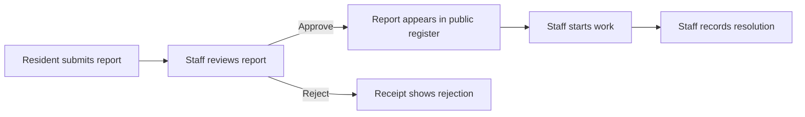
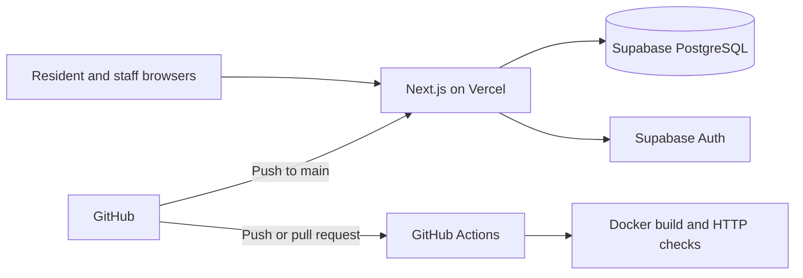

# AAPNO GAON

AAPNO GAON lets residents report local problems and track their report status.

[Live application on Vercel](https://aapno-gaon.vercel.app) · [GitHub Actions](https://github.com/labishbardiya/aapno-gaon/actions)

### Video walkthrough

[](https://aapno-gaon.vercel.app/walkthrough/index.html)

[Watch the walkthrough in your browser](https://aapno-gaon.vercel.app/walkthrough/index.html)

## Application pages

| Page | Function |
| --- | --- |
| `/report` | Submit a report with a ward, category, landmark, and description. You can add a map pin, photo, or private callback number. |
| `/track/<token>` | View the status and due date of your report. Keep this link private. |
| `/register` | Find approved reports. Filter the results or sort them by support count. Open a report to see its updates and approved photos. |
| `/overview` | View totals, resolution rates, and overdue reports by ward. |
| `/staff` | Review reports, set due dates, and record resolutions. |
| `/admin` | Manage routing rules, transfer reports, and review community submissions. |
| `/services` | View the ward directory, notices, guides, contacts, and the voter portal link. Send a lost-item, found-item, blood, or donor submission. |

Use the language button to select English or Hindi. Use **Menu → Install app** to see the available installation options.

## Report workflow



The private receipt shows the report status after submission.

## Configure the database

1. Apply the SQL files in [supabase/migrations](supabase/migrations) in filename order.
2. For demo data, run [supabase/seed.sql](supabase/seed.sql).
3. Copy `.env.example` to `.env.local`.
4. Set the variables below.

| Variable | Value |
| --- | --- |
| `DATABASE_URL` | PostgreSQL connection string. Use a TLS connection for hosted PostgreSQL. |
| `RECEIPT_SECRET` | Stable secret. Use `openssl rand -hex 32` to generate it. |
| `SUPABASE_URL` | Supabase project URL for staff sign-in. |
| `SUPABASE_PUBLISHABLE_KEY` | Supabase publishable key for staff sign-in. |
| `NEXT_PUBLIC_MAP_TILE_URL` | Optional map tile URL. The default uses OpenStreetMap. |
| `NEXT_PUBLIC_MAP_ATTRIBUTION` | Optional attribution for the selected tile source. |

Keep the database connection string and receipt secret in server environment variables.

## Run the application

Use Node.js 24 and npm for local development.

```sh
npm ci
npm run dev
```

For Docker, set a database URL that the container can reach.

```sh
docker build -t mysociety .
docker run --rm --env-file .env.local -p 3000:3000 mysociety
```

For either method, open [localhost:3000](http://localhost:3000). Check [the health endpoint](http://localhost:3000/api/health).

## Set up staff access

1. Create or invite the staff user in Supabase Auth.
2. Copy the user ID.
3. Add the user ID to `mysociety.staff_members`.
4. For an administrator, set `is_admin` to `true` for that row.
5. Sign in at `/staff`.

Use `/admin` to assign a staff member to a ward and category. New reports follow the rule. Staff can claim reports that have no assignment. Use the transfer control to change the owner of an existing report.

Set the ward center coordinates in `mysociety.wards` to show ward markers. Add local search entries to `mysociety.local_places`.

## Architecture and deployment



Mantine provides interface components. MapLibre shows maps. PostgreSQL stores reports and photos.

1. Import the GitHub repository into Vercel.
2. Select the Next.js preset.
3. Select Node.js 24.
4. Set the server environment variables.
5. Apply new database migrations before you deploy code that uses them.

## Local scaling demo

Use the [Docker scaling demo](demo/scale/README.md) to run four app instances behind Nginx and verify Redis cache sharing, PostgreSQL replication, and app failover with synthetic data.

## Verify the release

GitHub Actions checks types and builds the Docker image on each push and pull request. It applies the migrations to test PostgreSQL. It checks report submission, duplicate retries, private tracking, and public visibility.

1. Submit a demo report for a ward and category with a routing rule.
2. Open the private receipt.
3. Make sure that the report is absent from the public register before approval.
4. Sign in as the assigned staff member.
5. Approve the report.
6. Publish a due date.
7. Start work.
8. Resolve the report with a public note and, if available, an approved after photo.
9. Check the final status on the receipt and in the public register.
10. Check the ward totals in the overview.

## HTTP interfaces

| Endpoint | Result |
| --- | --- |
| `GET /api/health` | Application health. |
| `POST /api/reports` | Submit JSON with `wardId`, `category`, `landmark`, and `description`. Send a UUID v4 in the `Idempotency-Key` header. |
| `GET /open311/v2/services.json` | Civic service categories. |
| `GET /open311/v2/requests.json` | Up to 100 approved reports. Use service code, status, dates, or request IDs as filters. |
| `GET /open311/v2/requests/<ticket>.json` | One approved report. |

A new report returns HTTP 201. An identical retry within 24 hours returns HTTP 200 with the same receipt. A conflict returns HTTP 409. The daily report limit returns HTTP 429.

Open311 returns public data only. It maps resolved reports to `closed` and other approved reports to `open`. The date range is at most 90 days. Use the report form to submit a report.
